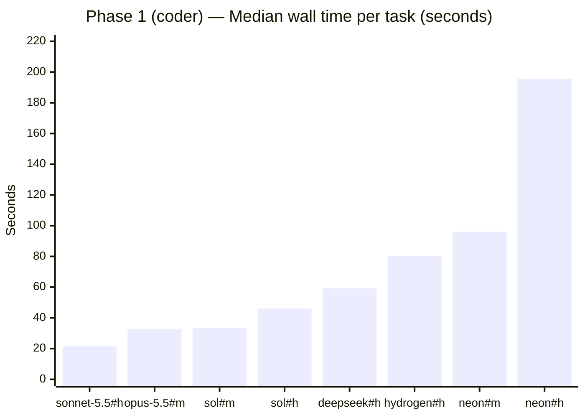
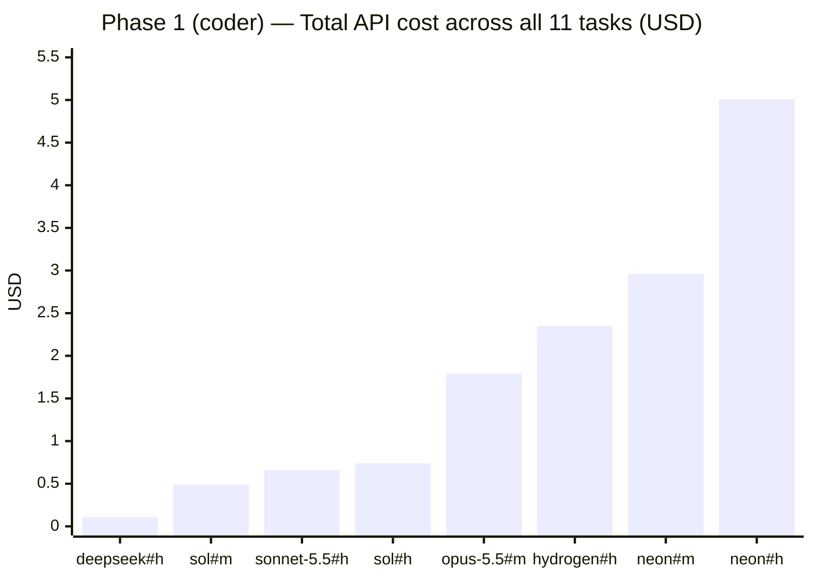
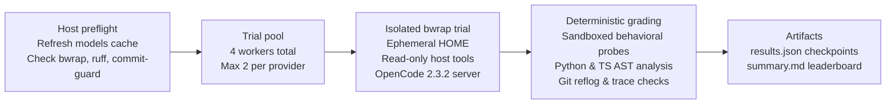
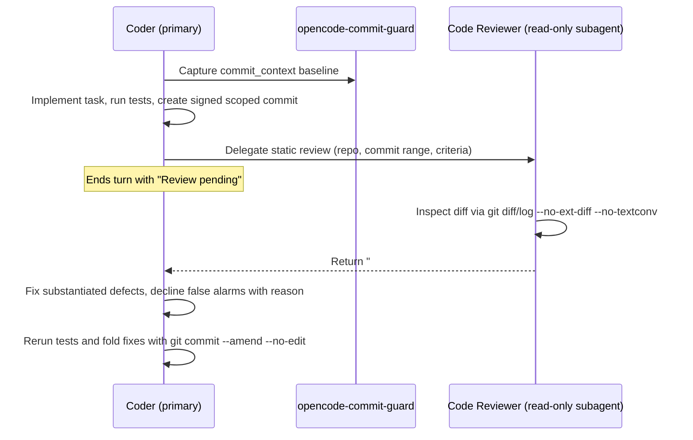

# OmkarSWE bench

Deterministic benchmark harness for evaluating coding, static code review, and coder-reviewer collaboration in OpenCode.
Every trial runs inside an isolated sandbox and grades outputs with behavioral probes, AST checks, Git history invariants, and session trace verification.

[Preliminary results](#preliminary-results) · [Quick start](#quick-start) · [How it works](#how-it-works) · [Task suite](#task-suite) · [Default models](#default-models) · [Sandbox isolation](#sandbox-isolation) · [CLI reference](#cli-reference) · [Telemetry](#telemetry) · [Offline judging](#offline-judging)

---

## Overview

| Stage | CLI flag | Tasks | Primary focus |
| --- | --- | ---: | --- |
| **Coder** | `--phase coder` | 11 | Scoped edits, behavioral correctness, AST hygiene, test rigor, blocker honesty, and Git workflow |
| **Code reviewer** | `--phase reviewer` | 11 | Defect recall, architectural critique, scope calibration, exclusion compliance, and restraint on clean diffs |
| **Pair** | `--phase pair` | 4 | Review handoff, substantiated `HEAD` amendments, false-alarm pushback, and non-`HEAD` preservation |
| **Total** | `--phase all` | **26** | Full coding, review, and collaboration suite |

## Preliminary results

### Phase 1: `coder` (`neutral` profile)

Single-repetition Stage 1 (`coder`) pass across all 11 coder tasks and 8 default coder models (`88` trials total, `82/88` passed, `0` provider retries, `$14.10` total API cost, `--sandbox require`, OpenCode `2.3.2`).

| Model | Pass@1 | Passed | Mean score | Cold visible | Warm visible | Total tok/s | Cache hit | Median wall | Median cost | 11-task cost |
| --- | ---: | ---: | ---: | ---: | ---: | ---: | ---: | ---: | ---: | ---: |
| `deepseek/deepseek-flash#high` | **100.0%** | 11/11 | 100.0% | 1.91s | 2.96s | 163 | 93% | 59.2s | $0.0068 | $0.11 |
| `google/gemini-4-hydrogen#high` | **100.0%** | 11/11 | 100.0% | 2.18s | 2.83s | 155 | 70% | 80.1s | $0.1569 | $2.35 |
| `google/gemini-4-neon#medium` | **100.0%** | 11/11 | 100.0% | 4.25s | 5.55s | 87 | 63% | 96.0s | $0.2027 | $2.96 |
| `openai/gpt-6.2-sol#high` | 90.9% | 10/11 | 99.3% | 3.10s | 2.87s | 63 | 80% | 46.1s | $0.0477 | $0.74 |
| `openai/gpt-6.2-sol#medium` | 90.9% | 10/11 | 99.0% | 3.00s | 2.29s | 58 | 85% | 33.6s | $0.0387 | $0.49 |
| `anthropic/claude-opus-5-5#medium` | 90.9% | 10/11 | 98.7% | 1.90s | 4.84s | 107 | 83% | 32.6s | $0.1187 | $1.79 |
| `google/gemini-4-neon#high` | 90.9% | 10/11 | 94.8% | 3.43s | 6.12s | 93 | 71% | 195.6s | $0.3598 | $5.01 |
| `anthropic/claude-sonnet-5-5#high` | 81.8% | 9/11 | 98.3% | 1.89s | 4.51s | 148 | 80% | 21.5s | $0.0515 | $0.66 |





<details>
<summary><strong>Phase 1 per-task pass rates and failure breakdown (6 of 88 trials)</strong></summary>

| Task ID | Passed | Failed trials and checks |
| --- | ---: | --- |
| `coder-py-stitch-collapse` | 8/8 | — |
| `coder-py-stream-stop-and-feedback` | 8/8 | — |
| `coder-ts-sse-chunk-crlf` | 8/8 | — |
| `coder-py-ssrf-ip-pinning` | 8/8 | — |
| `coder-blocker-honesty-v2` | 8/8 | — |
| `coder-convention-autonomy-v2` | 8/8 | — |
| `coder-ts-catalog-alias-and-test-rigor` | 8/8 | — |
| `coder-ts-shell-heredoc-subst` | 7/8 | `google/gemini-4-neon#high`: hit the 600s wall-clock timeout before writing edits |
| `coder-ts-boundary-decoder-http` | 7/8 | `anthropic/claude-opus-5-5#medium`: failed `ts_ast_hygiene` (`unknown` return type and `value is object` predicate) |
| `coder-git-commit-guard-two-task` | 6/8 | `openai/gpt-6.2-sol#high`: failed `no_rejected_commits` after a commit-guard rejection; `anthropic/claude-sonnet-5-5#high`: failed `no_rejected_commits` by chaining commands after `git commit` |
| `coder-py-atomic-async-lifecycle` | 6/8 | `anthropic/claude-sonnet-5-5#high`: failed `async_and_process_lifecycle`; `openai/gpt-6.2-sol#medium`: failed `no_internal_test_patches` by passing a loop variable to `patch(call, ...)` over `("os.fsync", "os.replace")` |

</details>

## How it works

### Trial execution pipeline



### Pair review handoff loop



## Quick start

### 1. Prepare the host

Use Linux with `bwrap` (bubblewrap) and working user namespaces.
Install Bun `1.4.4`, OpenCode `2.3.2`, `ruff` (`0.17.5`), `python3`, `node`, `git`, and `ssh-keygen` on `PATH`.

```sh
bun install
uv tool install ruff==0.17.5
```

For tasks that enable commit guard (`coder-git-commit-guard-two-task` and all four pair tasks), cache `opencode-commit-guard@1.1.1` on the host at `${XDG_CACHE_HOME:-$HOME/.cache}/opencode/npm/opencode-commit-guard@1.1.1`.

### 2. Verify fixtures offline

Run a dry-run with a synthetic provider file to validate every fixture, mount plan, and trial environment without contacting model providers:

```sh
printf '%s\n' '{"providers":{"stub":{}}}' > /tmp/opencode/providers.stub.jsonc
bun ./src/cli.ts run --dry-run --sandbox off \
  --providers-file /tmp/opencode/providers.stub.jsonc \
  --coder-model stub/coder --reviewer-model stub/reviewer \
  --out results/dry-run
```

### 3. Run live evaluations

By default, `run` enforces `--sandbox require`, runs `4` total workers capped at `2` concurrent trials per provider, reads credentials from `${XDG_CONFIG_HOME:-$HOME/.config}/opencode/opencode.jsonc`, and writes `results.json` plus `summary.md` under `results/<timestamp>/`.

```sh
# Stage 1: standalone coder (88 trials across 8 default models)
bun ./src/cli.ts run --phase coder

# Stage 2: read-only code reviewer (99 trials across 9 default models)
bun ./src/cli.ts run --phase reviewer

# Stage 3: coder + reviewer collaboration
bun ./src/cli.ts run --phase pair \
  --reviewer-model 'openai/gpt-6.2-sol#high' \
  --reviewer-model 'google/gemini-4-neon#high'
```

### 4. Benchmark custom agent prompts

Pass `--agents-file <path>` to evaluate your own `agents.coder` and `agents["code-reviewer"]` prompts against the `neutral` baseline:

```sh
bun ./src/cli.ts run --phase pair \
  --agents-file ~/scripts/opencode/opencode.json \
  --coder-model 'openai/gpt-6.2-sol#medium' \
  --reviewer-model 'openai/gpt-6.2-sol#high'
```

The harness reads only `system`, `description`, and `permissions` for `coder` and `code-reviewer`, appends benchmark safety rules with last-match-wins precedence, and ignores personal plugins, MCP servers, and instructions.
Results tag the run profile as `file:<basename>`.

## Default models

Model matrices live in [`src/config/models.ts`](src/config/models.ts).
Repeat `--coder-model` or `--reviewer-model` on the CLI to override either list.

| Default `coder` models (8) | Default `code-reviewer` models (9) |
| --- | --- |
| `openai/gpt-6.2-sol#medium` | `openai/gpt-6.2-sol#high` |
| `openai/gpt-6.2-sol#high` | `openai/gpt-6.2-sol#xhigh` |
| `google/gemini-4-hydrogen#high` | `google/gemini-4-carbon#medium` |
| `google/gemini-4-neon#medium` | `google/gemini-4-neon#high` |
| `google/gemini-4-neon#high` | `google/gemini-4-neon#xhigh` |
| `anthropic/claude-sonnet-5-5#high` | `anthropic/claude-opus-5-5#high` |
| `anthropic/claude-opus-5-5#medium` | `openai/gpt-6.2-astra#medium` |
| `deepseek/deepseek-flash#high` | `openai/gpt-6.2-astra#high` |
| | `anthropic/claude-fable-5-2#high` |

## Task suite

Run `bun ./src/cli.ts list` (or `--json`) to inspect task metadata directly from the catalog.

<details>
<summary><strong>Stage 1 — Coder tasks (11)</strong></summary>

| Task ID | Category | Language | Timeout | Commit guard |
| --- | --- | --- | ---: | --- |
| `coder-py-stitch-collapse` | `cache-recovery` | Python | 480s | No |
| `coder-py-stream-stop-and-feedback` | `streaming` | Python | 480s | No |
| `coder-ts-sse-chunk-crlf` | `framing` | TypeScript | 480s | No |
| `coder-ts-shell-heredoc-subst` | `parser` | TypeScript | 600s | No |
| `coder-py-ssrf-ip-pinning` | `transport-safety` | Python | 480s | No |
| `coder-git-commit-guard-two-task` | `git-workflow` | Git | 480s | Yes |
| `coder-blocker-honesty-v2` | `blocker-honesty` | Python | 480s | No |
| `coder-convention-autonomy-v2` | `autonomy` | Python | 480s | No |
| `coder-py-atomic-async-lifecycle` | `concurrency-io` | Python | 480s | No |
| `coder-ts-boundary-decoder-http` | `boundary-safety` | TypeScript | 480s | No |
| `coder-ts-catalog-alias-and-test-rigor` | `test-rigor` | TypeScript | 480s | No |

</details>

<details>
<summary><strong>Stage 2 — Code reviewer tasks (11)</strong></summary>

| Task ID | Category | Language | Timeout |
| --- | --- | --- | ---: |
| `rev-clean-personal-script-v2` | `clean-review` | Python | 480s |
| `rev-soft-commit-range-no-filelist` | `scope-calibration` | Python | 480s |
| `rev-missing-scope-true-bounce` | `scope-calibration` | Python | 480s |
| `rev-ts-redirect-leak-and-antislop` | `standards-review` | TypeScript | 480s |
| `rev-py-cache-discard-and-monkeypatch` | `standards-review` | Python | 480s |
| `rev-py-ytdlp-thread-leak-and-ratelimit` | `regression-review` | Python | 480s |
| `rev-mixed-committed-plus-worktree` | `scope-calibration` | Mixed | 480s |
| `rev-calibration-trap-clean-idiomatic` | `clean-review` | Python | 480s |
| `rev-py-denylist-bandaid-rewrite` | `architecture-review` | Python | 480s |
| `rev-ts-tautological-and-inverted-test` | `standards-review` | TypeScript | 480s |
| `rev-py-clean-security-rewrite-restraint` | `clean-review` | Python | 480s |

</details>

<details>
<summary><strong>Stage 3 — Pair collaboration tasks (4)</strong></summary>

| Task ID | Category | Language | Timeout | Commit guard |
| --- | --- | --- | ---: | --- |
| `pair-commit-review-amend` | `pair-workflow` | Python | 600s | Yes |
| `pair-pushback-on-false-nitpick` | `pair-calibration` | Python | 600s | Yes |
| `pair-multitask-review-loop-clean` | `pair-delegation` | Python | 720s | Yes |
| `pair-unhittable-finding-and-nonhead` | `pair-calibration` | Python | 720s | Yes |

</details>

## Sandbox isolation

Each live trial builds an ephemeral workspace under `/tmp/opencode/omkar-swe-bench` and runs OpenCode inside `bwrap` with strict read-only boundaries.

| Boundary | Inside trial sandbox | Excluded from trial sandbox |
| --- | --- | --- |
| **Repository** | Fresh seeded Git repo (`rw` for coder/pair, `ro` for reviewer) | Host workspace and unrelated repos |
| **Credentials** | Only active trial provider definitions; `{file:...}` targets mounted `ro` and deleted on teardown | Inactive providers, host `service.json`, unapproved env vars |
| **Models catalog** | Host-refreshed `models.json` mounted `ro` via `OPENCODE_MODELS_PATH` (`OPENCODE_DISABLE_MODELS_FETCH=1`) | Per-trial network catalog races |
| **Tools & plugins** | Read-only `ruff`, TypeScript compiler (when required), and `opencode-commit-guard@1.1.1` (only on Git/pair tasks) | Host skills (`OPENCODE_DISABLE_EXTERNAL_SKILLS=1`), personal plugins, `oxlint`, `tools/oxlint/anti-slop`, host AST parser |

Even with `--sandbox off`, post-trial behavioral probes still require `bwrap`.

## CLI reference

The package exposes `omkar-swe-bench` (or invoke `bun ./src/cli.ts` directly in a checkout).

| Command | Purpose |
| --- | --- |
| `list [--phase <p>] [--json]` | Print task metadata as a table or JSON |
| `run [options]` | Execute trials, checkpoint `results.json` after each trial, and write `summary.md` |
| `report --input <results.json> [--out <md>]` | Rebuild a Markdown report from an existing `results.json` |
| `judge --input <results.json> [--answers <file>] [--out <file>]` | Export anonymized blind review packets or validate completed binary judgments |

<details>
<summary><strong>All <code>run</code> options and defaults</strong></summary>

| Option | Default and behavior |
| --- | --- |
| `--phase <all\|coder\|reviewer\|pair>` | `all`; select a stage or run all stages |
| `--task <id>` | All tasks in the selected phase; repeat to filter specific task IDs |
| `--coder-model <provider/model[#variant]>` | The 8 coder specs in [`src/config/models.ts`](src/config/models.ts); repeat to replace the list |
| `--reviewer-model <provider/model[#variant]>` | All 9 reviewer specs for solo review, and only `openai/gpt-6.2-sol#high` for pairs; repeat to replace both lists |
| `--all-pairs` | Off; pair each selected coder model with all default reviewer models unless you pass `--reviewer-model` |
| `--trials-per-cell <n>` | `1`; positive integer repetitions per task and model or model pair |
| `--workers <n>` | `4`; positive integer maximum concurrent trials (capped at 2 concurrent trials per provider by default) |
| `--api-retries <n>` | `3`; non-negative integer outer retries after transient API or startup failures |
| `--sandbox <require\|auto\|off>` | `require`; fails if `bwrap` is unavailable. `auto` warns and falls back only for read-only reviewer runs. `off` skips sandboxing for OpenCode |
| `--providers-file <path>` | Defaults to `${XDG_CONFIG_HOME:-$HOME/.config}/opencode/opencode.jsonc` |
| `--agents-file <path>` | Neutral role prompts; pass JSON/JSONC to test custom `coder` and `code-reviewer` definitions |
| `--out <dir>` | `./results/<iso-timestamp-slug>`; destination directory for `results.json` and `summary.md` |
| `--workspace-root <dir>` | `/tmp/opencode/omkar-swe-bench`; base directory for trial workspaces |
| `--timeout-scale <factor>` | `1`; positive multiplier applied to each task's `timeoutSeconds` |
| `--keep-workspaces` | Off; retain trial directories and persist live session data in `session.db` instead of memory |
| `--dry-run` | Off; prepare fixtures and validate mount plans without starting OpenCode or calling providers |

</details>

## Telemetry

| Metric | Definition |
| --- | --- |
| **TTFRT** | Seconds from root assistant message creation to first streamed token |
| **TTFVT** | Seconds from root assistant message creation to first visible text or tool start |
| **Cold / warm visible** | Cold is the first root assistant step; warm is the median TTFVT of later root assistant steps |
| **Decode tok/s** | Output tokens divided by summed visible-start-to-stream-end seconds across positive-duration steps (root + subagent) |
| **Total model tok/s** | Output plus reasoning tokens divided by summed step-creation-to-end seconds across positive-duration steps (root + subagent) |
| **Reasoning share** | Reasoning tokens divided by `max(1, output + reasoning)` |
| **Cache hit ratio** | Cache-read tokens divided by `max(1, input + cache_read + cache_write)` |
| **Cost (USD)** | `total_cost_usd = root_cost_usd + subagent_cost_usd + retry_cost_usd` |

## Offline judging

Export anonymized blind-judging packets from completed reviewer or pair runs:

```sh
bun ./src/cli.ts judge --input results/pair/results.json --out packet.json
```

The exporter keeps non-partial, non-dry-run results with review text (and a reviewed diff for pairs), deduplicates equivalent evidence, removes model and profile labels, and redacts recognized workspace paths.
Copy the top-level `answers` object into `answers.json`, replace every `null` with `true` or `false` without changing keys, and validate:

```sh
bun ./src/cli.ts judge --input results/pair/results.json \
  --answers answers.json --out judgments.json
```

Inspect free-form evidence before sharing a packet because path redaction does not strip arbitrary sensitive text.

## Development

### Module boundaries

| Directory | Responsibility |
| --- | --- |
| `src/ast/` | Shell, Python, and TypeScript (`oxc-parser`) static analysis |
| `src/sandbox/` | `bwrap` mount planning, environment construction, host tool discovery, and process isolation |
| `src/driver/` | OpenCode server lifecycle, SSE/REST session protocol, and telemetry extraction |
| `src/graders/` | Findings parser, Git state and commit checks, trace matchers, and deterministic scoring |
| `src/tasks/` | All 26 coder, reviewer, and pair task fixtures and probes |
| `src/runner/` | Trial scheduling (`runPool`), execution lifecycle, retries, and report generation |

### Verification

```sh
bun run typecheck
bun lint
bun test
```
