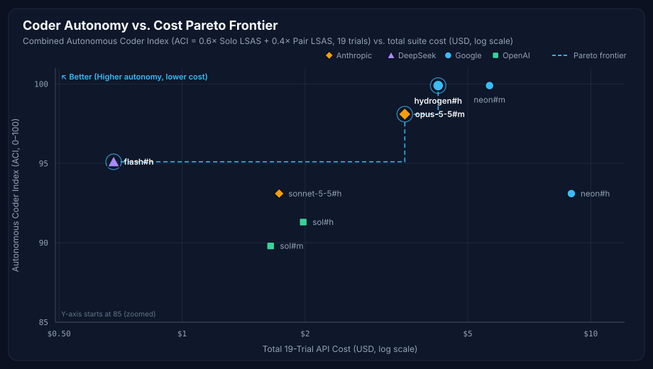
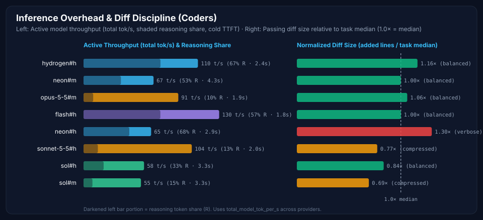
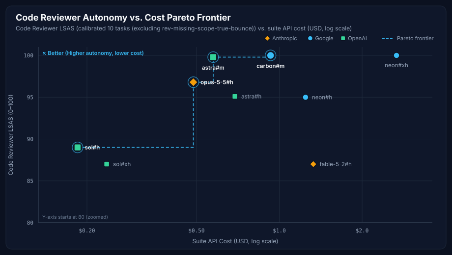
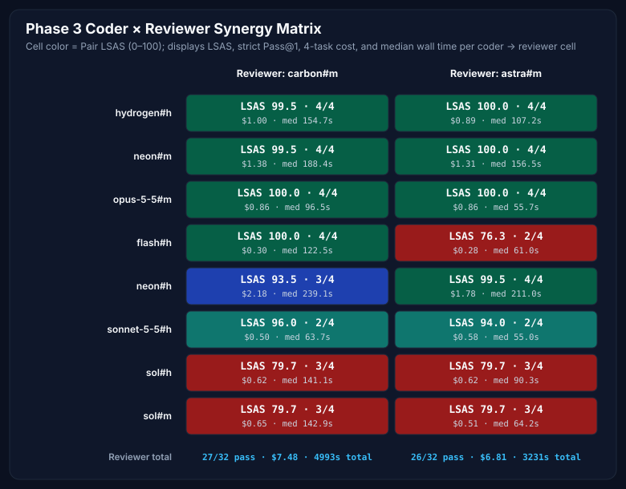
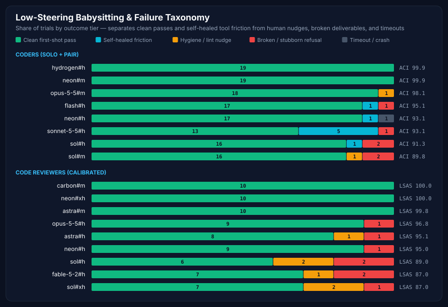

# OmkarSWE bench — Full Evaluation Report

Evaluated **251** trials (**211/251** strict Pass@1, **84.1%**, **$37.74** total API cost).

Open [`report.html`](report.html) in a browser for the interactive dashboard with hover tooltips and phase tabs.

## Scoring methodology

- **LSAS (Low-Steering Autonomy Score, 0–100):** Zeroes timeouts, crashes, and partial runs. Caps broken deliverables or scope violations at `<= 25`. Passing deliverables start at `100` minus `-35` per static/test hygiene miss, `-20` per skipped verification check, `-8` per self-healed in-session friction item (such as a commit-guard rejection recovered autonomously), and `-2` per root tool error (capped at `-8`). For code reviewers, LSAS starts at `100 × recall` (`100` on clean diffs) minus `-30` per blocking `P0–P2` false alarm and `-15` per `P3` nitpick.
- **ZSDR (Zero-Steering Deliverable Rate):** Share of trials needing zero human intervention after the session ends.
- **ACI (Autonomous Coder Index):** `0.6 × Solo LSAS + 0.4 × Pair LSAS` across all 19 coder trials (Phases 1 and 3).
- **Cost and Wall Time:** Reported on orthogonal Pareto axes rather than blended into capability scores.

## Combined Autonomous Coder Index (Phases 1 + 3)

| Rank | Coder | ACI | Solo LSAS | Pair LSAS | ZSDR | Pass@1 | 19-trial cost | $/clean pass | Total wall | Active tok/s | Diff ratio |
| --- | --- | --- | --- | --- | --- | --- | --- | --- | --- | --- | --- |
| 1 | `google/gemini-4-hydrogen#high` | 99.9 | 100.0 | 99.8 | 100.0% (19/19) | 100.0% (19/19) | $4.23 | $0.223 | 2400s | 110 | 1.16× |
| 2 | `google/gemini-4-neon#medium` | 99.9 | 100.0 | 99.8 | 100.0% (19/19) | 100.0% (19/19) | $5.65 | $0.298 | 2722s | 67 | 1.00× |
| 3 | `anthropic/claude-opus-5-5#medium` | 98.1 | 96.8 | 100.0 | 94.7% (18/19) | 94.7% (18/19) | $3.51 | $0.195 | 1166s | 91 | 1.06× |
| 4 | `deepseek/deepseek-flash#high` | 95.1 | 99.8 | 88.1 | 94.7% (18/19) | 89.5% (17/19) | $0.68 | $0.040 | 1718s | 130 | 1.00× |
| 5 | `google/gemini-4-neon#high` | 93.1 | 90.9 | 96.5 | 94.7% (18/19) | 89.5% (17/19) | $8.96 | $0.527 | 4341s | 65 | 1.30× |
| 6 | `anthropic/claude-sonnet-5-5#high` | 93.1 | 91.9 | 95.0 | 94.7% (18/19) | 68.4% (13/19) | $1.73 | $0.133 | 792s | 104 | 0.77× |
| 7 | `openai/gpt-6.2-sol#high` | 91.3 | 99.1 | 79.7 | 89.5% (17/19) | 84.2% (16/19) | $1.98 | $0.124 | 1678s | 58 | 0.84× |
| 8 | `openai/gpt-6.2-sol#medium` | 89.8 | 96.6 | 79.7 | 84.2% (16/19) | 84.2% (16/19) | $1.65 | $0.103 | 1405s | 55 | 0.69× |

## Phase 1 — Standalone coder leaderboard

| Rank | Model | LSAS | ZSDR | Pass@1 | Passed | Mean check | Diff ratio | Suite cost | Med wall | Cold TTFT | Active tok/s | Reasoning % |
| --- | --- | --- | --- | --- | --- | --- | --- | --- | --- | --- | --- | --- |
| 1 | `google/gemini-4-hydrogen#high` | 100.0 | 100.0% | 100.0% | 11/11 | 100.0% | 1.12× | $2.35 | 80.1s | 2.18s | 155 | 76% |
| 2 | `google/gemini-4-neon#medium` | 100.0 | 100.0% | 100.0% | 11/11 | 100.0% | 1.15× | $2.96 | 96.0s | 4.25s | 87 | 68% |
| 3 | `deepseek/deepseek-flash#high` | 99.8 | 100.0% | 100.0% | 11/11 | 100.0% | 1.00× | $0.11 | 59.2s | 1.91s | 163 | 71% |
| 4 | `openai/gpt-6.2-sol#high` | 99.1 | 100.0% | 90.9% | 10/11 | 99.3% | 0.78× | $0.74 | 46.1s | 3.10s | 63 | 33% |
| 5 | `anthropic/claude-opus-5-5#medium` | 96.8 | 90.9% | 90.9% | 10/11 | 98.7% | 1.04× | $1.79 | 32.6s | 1.90s | 107 | 10% |
| 6 | `openai/gpt-6.2-sol#medium` | 96.6 | 90.9% | 90.9% | 10/11 | 99.0% | 0.61× | $0.49 | 33.6s | 3.00s | 58 | 15% |
| 7 | `anthropic/claude-sonnet-5-5#high` | 91.9 | 90.9% | 81.8% | 9/11 | 98.3% | 0.77× | $0.66 | 21.5s | 1.89s | 148 | 13% |
| 8 | `google/gemini-4-neon#high` | 90.9 | 90.9% | 90.9% | 10/11 | 94.8% | 1.49× | $5.01 | 195.6s | 3.43s | 93 | 73% |

## Phase 2 — Code reviewer leaderboard (calibrated, excluding `rev-missing-scope-true-bounce`)

| Rank | Model | LSAS | Pass@1 | Passed | Defect recall | P0–P2 FPs | P3 nits | Suite cost | Med wall | Cold TTFT | Active tok/s | Reasoning % |
| --- | --- | --- | --- | --- | --- | --- | --- | --- | --- | --- | --- | --- |
| 1 | `google/gemini-4-carbon#medium` | 100.0 | 100.0% | 10/10 | 100.0% | 0 | 0 | $0.93 | 85.2s | 8.52s | 63 | 87% |
| 2 | `google/gemini-4-neon#xhigh` | 100.0 | 100.0% | 10/10 | 100.0% | 0 | 0 | $2.67 | 138.8s | 9.26s | 106 | 94% |
| 3 | `openai/gpt-6.2-astra#medium` | 99.8 | 100.0% | 10/10 | 100.0% | 0 | 0 | $0.58 | 15.8s | 5.79s | 26 | 1% |
| 4 | `anthropic/claude-opus-5-5#high` | 96.8 | 90.0% | 9/10 | 100.0% | 1 | 0 | $0.49 | 18.0s | 2.23s | 78 | 28% |
| 5 | `openai/gpt-6.2-astra#high` | 95.1 | 80.0% | 8/10 | 100.0% | 1 | 1 | $0.69 | 20.0s | 5.69s | 34 | 12% |
| 6 | `google/gemini-4-neon#high` | 95.0 | 90.0% | 9/10 | 92.9% | 0 | 0 | $1.25 | 60.8s | 6.67s | 90 | 89% |
| 7 | `openai/gpt-6.2-sol#high` | 89.0 | 60.0% | 6/10 | 92.9% | 1 | 2 | $0.18 | 16.2s | 4.67s | 45 | 37% |
| 8 | `anthropic/claude-fable-5-2#high` | 87.0 | 70.0% | 7/10 | 100.0% | 3 | 2 | $1.33 | 19.6s | 1.76s | 92 | 29% |
| 9 | `openai/gpt-6.2-sol#xhigh` | 87.0 | 70.0% | 7/10 | 85.7% | 2 | 2 | $0.24 | 23.2s | 4.70s | 48 | 60% |

### All Phase 2 tasks (including 0%-pass bounce fixture)

| Rank | Model | LSAS | Pass@1 | Passed | Defect recall | P0–P2 FPs | P3 nits | Suite cost | Med wall | Cold TTFT | Active tok/s | Reasoning % |
| --- | --- | --- | --- | --- | --- | --- | --- | --- | --- | --- | --- | --- |
| 1 | `google/gemini-4-carbon#medium` | 90.9 | 90.9% | 10/11 | 100.0% | 0 | 0 | $1.31 | 88.8s | 8.35s | 65 | 88% |
| 2 | `google/gemini-4-neon#xhigh` | 90.9 | 90.9% | 10/11 | 100.0% | 1 | 0 | $2.97 | 154.6s | 9.19s | 104 | 95% |
| 3 | `openai/gpt-6.2-astra#medium` | 90.7 | 90.9% | 10/11 | 100.0% | 1 | 0 | $0.61 | 15.2s | 5.65s | 26 | 0% |
| 4 | `anthropic/claude-opus-5-5#high` | 89.4 | 81.8% | 9/11 | 100.0% | 1 | 0 | $0.52 | 15.4s | 2.20s | 78 | 27% |
| 5 | `openai/gpt-6.2-astra#high` | 86.5 | 72.7% | 8/11 | 100.0% | 2 | 1 | $0.73 | 20.0s | 5.74s | 32 | 9% |
| 6 | `google/gemini-4-neon#high` | 86.4 | 81.8% | 9/11 | 92.9% | 1 | 0 | $1.35 | 55.3s | 6.57s | 89 | 90% |
| 7 | `openai/gpt-6.2-sol#high` | 80.9 | 54.5% | 6/11 | 92.9% | 2 | 2 | $0.20 | 15.8s | 4.63s | 44 | 33% |
| 8 | `anthropic/claude-fable-5-2#high` | 80.5 | 63.6% | 7/11 | 100.0% | 3 | 2 | $1.41 | 19.5s | 1.87s | 91 | 28% |
| 9 | `openai/gpt-6.2-sol#xhigh` | 79.1 | 63.6% | 7/11 | 85.7% | 3 | 2 | $0.25 | 23.1s | 4.69s | 46 | 59% |

## Phase 3 — Pair collaboration leaderboard

| Rank | Model | LSAS | ZSDR | Pass@1 | Passed | Mean check | Diff ratio | Suite cost | Med wall | Cold TTFT | Active tok/s | Reasoning % |
| --- | --- | --- | --- | --- | --- | --- | --- | --- | --- | --- | --- | --- |
| 1 | `anthropic/claude-opus-5-5#medium -> openai/gpt-6.2-astra#medium` | 100.0 | 100.0% | 100.0% | 4/4 | 100.0% | 1.08× | $0.86 | 55.7s | 2.23s | 77 | 3% |
| 2 | `anthropic/claude-opus-5-5#medium -> google/gemini-4-carbon#medium` | 100.0 | 100.0% | 100.0% | 4/4 | 100.0% | 1.09× | $0.86 | 96.5s | 1.79s | 68 | 35% |
| 3 | `google/gemini-4-hydrogen#high -> openai/gpt-6.2-astra#medium` | 100.0 | 100.0% | 100.0% | 4/4 | 100.0% | 1.04× | $0.89 | 107.2s | 2.42s | 88 | 56% |
| 4 | `deepseek/deepseek-flash#high -> google/gemini-4-carbon#medium` | 100.0 | 100.0% | 100.0% | 4/4 | 100.0% | 1.11× | $0.30 | 122.5s | 1.80s | 97 | 54% |
| 5 | `google/gemini-4-neon#medium -> openai/gpt-6.2-astra#medium` | 100.0 | 100.0% | 100.0% | 4/4 | 100.0% | 0.88× | $1.31 | 156.5s | 5.20s | 40 | 44% |
| 6 | `google/gemini-4-hydrogen#high -> google/gemini-4-carbon#medium` | 99.5 | 100.0% | 100.0% | 4/4 | 100.0% | 1.32× | $1.00 | 154.7s | 2.41s | 82 | 65% |
| 7 | `google/gemini-4-neon#medium -> google/gemini-4-carbon#medium` | 99.5 | 100.0% | 100.0% | 4/4 | 100.0% | 0.97× | $1.38 | 188.4s | 3.68s | 52 | 52% |
| 8 | `google/gemini-4-neon#high -> openai/gpt-6.2-astra#medium` | 99.5 | 100.0% | 100.0% | 4/4 | 100.0% | 1.31× | $1.78 | 211.0s | 2.97s | 49 | 56% |
| 9 | `anthropic/claude-sonnet-5-5#high -> google/gemini-4-carbon#medium` | 96.0 | 100.0% | 50.0% | 2/4 | 96.7% | 0.95× | $0.50 | 63.7s | 1.47s | 96 | 34% |
| 10 | `anthropic/claude-sonnet-5-5#high -> openai/gpt-6.2-astra#medium` | 94.0 | 100.0% | 50.0% | 2/4 | 94.0% | 0.75× | $0.58 | 55.0s | 2.59s | 79 | 6% |
| 11 | `google/gemini-4-neon#high -> google/gemini-4-carbon#medium` | 93.5 | 100.0% | 75.0% | 3/4 | 95.8% | 1.09× | $2.18 | 239.1s | 2.82s | 63 | 69% |
| 12 | `openai/gpt-6.2-sol#medium -> openai/gpt-6.2-astra#medium` | 79.7 | 75.0% | 75.0% | 3/4 | 89.6% | 0.83× | $0.51 | 64.2s | 3.31s | 44 | 7% |
| 13 | `openai/gpt-6.2-sol#high -> openai/gpt-6.2-astra#medium` | 79.7 | 75.0% | 75.0% | 3/4 | 89.6% | 0.89× | $0.62 | 90.3s | 3.39s | 43 | 13% |
| 14 | `openai/gpt-6.2-sol#high -> google/gemini-4-carbon#medium` | 79.7 | 75.0% | 75.0% | 3/4 | 89.6% | 0.89× | $0.62 | 141.1s | 4.03s | 57 | 49% |
| 15 | `openai/gpt-6.2-sol#medium -> google/gemini-4-carbon#medium` | 79.7 | 75.0% | 75.0% | 3/4 | 87.5% | 0.80× | $0.65 | 142.9s | 3.52s | 56 | 60% |
| 16 | `deepseek/deepseek-flash#high -> openai/gpt-6.2-astra#medium` | 76.3 | 75.0% | 50.0% | 2/4 | 88.8% | 1.04× | $0.28 | 61.0s | 1.72s | 117 | 29% |

## Diagnostics

## Per-trial breakdown

| Task | Role | Model | Tier | LSAS | Pass | Raw score | Wall | Cost | Notes |
| --- | --- | --- | --- | --- | --- | --- | --- | --- | --- |
| coder-py-stitch-collapse | coder | openai/gpt-6.2-sol#medium | clean_pass | 100.0 | Yes | 100.0% | 32.4s | $0.0339 |  |
| coder-py-stitch-collapse | coder | openai/gpt-6.2-sol#high | clean_pass | 100.0 | Yes | 100.0% | 30.5s | $0.0384 |  |
| coder-py-stitch-collapse | coder | google/gemini-4-hydrogen#high | clean_pass | 100.0 | Yes | 100.0% | 80.1s | $0.1569 |  |
| coder-py-stitch-collapse | coder | google/gemini-4-neon#medium | clean_pass | 100.0 | Yes | 100.0% | 94.4s | $0.1949 |  |
| coder-py-stitch-collapse | coder | google/gemini-4-neon#high | clean_pass | 100.0 | Yes | 100.0% | 195.6s | $0.3598 |  |
| coder-py-stitch-collapse | coder | anthropic/claude-sonnet-5-5#high | clean_pass | 100.0 | Yes | 100.0% | 16.6s | $0.0460 |  |
| coder-py-stitch-collapse | coder | anthropic/claude-opus-5-5#medium | clean_pass | 100.0 | Yes | 100.0% | 28.8s | $0.1187 |  |
| coder-py-stitch-collapse | coder | deepseek/deepseek-flash#high | clean_pass | 100.0 | Yes | 100.0% | 59.2s | $0.0068 |  |
| coder-py-stream-stop-and-feedback | coder | openai/gpt-6.2-sol#medium | clean_pass | 100.0 | Yes | 100.0% | 36.7s | $0.0331 |  |
| coder-py-stream-stop-and-feedback | coder | openai/gpt-6.2-sol#high | clean_pass | 100.0 | Yes | 100.0% | 38.3s | $0.0428 |  |
| coder-py-stream-stop-and-feedback | coder | google/gemini-4-hydrogen#high | clean_pass | 100.0 | Yes | 100.0% | 58.8s | $0.1179 |  |
| coder-py-stream-stop-and-feedback | coder | google/gemini-4-neon#medium | clean_pass | 100.0 | Yes | 100.0% | 87.4s | $0.2027 |  |
| coder-py-stream-stop-and-feedback | coder | google/gemini-4-neon#high | clean_pass | 100.0 | Yes | 100.0% | 114.4s | $0.3299 |  |
| coder-py-stream-stop-and-feedback | coder | anthropic/claude-sonnet-5-5#high | clean_pass | 100.0 | Yes | 100.0% | 20.9s | $0.0389 |  |
| coder-py-stream-stop-and-feedback | coder | anthropic/claude-opus-5-5#medium | clean_pass | 100.0 | Yes | 100.0% | 32.6s | $0.0997 |  |
| coder-py-stream-stop-and-feedback | coder | deepseek/deepseek-flash#high | clean_pass | 100.0 | Yes | 100.0% | 46.3s | $0.0052 |  |
| coder-ts-sse-chunk-crlf | coder | openai/gpt-6.2-sol#medium | clean_pass | 100.0 | Yes | 100.0% | 29.3s | $0.0387 |  |
| coder-ts-sse-chunk-crlf | coder | openai/gpt-6.2-sol#high | clean_pass | 100.0 | Yes | 100.0% | 46.1s | $0.0477 |  |
| coder-ts-sse-chunk-crlf | coder | google/gemini-4-hydrogen#high | clean_pass | 100.0 | Yes | 100.0% | 90.3s | $0.1749 |  |
| coder-ts-sse-chunk-crlf | coder | google/gemini-4-neon#medium | clean_pass | 100.0 | Yes | 100.0% | 166.3s | $0.3118 |  |
| coder-ts-sse-chunk-crlf | coder | google/gemini-4-neon#high | clean_pass | 100.0 | Yes | 100.0% | 262.0s | $0.6140 |  |
| coder-ts-sse-chunk-crlf | coder | anthropic/claude-sonnet-5-5#high | clean_pass | 100.0 | Yes | 100.0% | 23.4s | $0.0515 |  |
| coder-ts-sse-chunk-crlf | coder | anthropic/claude-opus-5-5#medium | clean_pass | 100.0 | Yes | 100.0% | 38.3s | $0.1267 |  |
| coder-ts-sse-chunk-crlf | coder | deepseek/deepseek-flash#high | clean_pass | 100.0 | Yes | 100.0% | 71.7s | $0.0086 |  |
| coder-ts-shell-heredoc-subst | coder | openai/gpt-6.2-sol#medium | clean_pass | 100.0 | Yes | 100.0% | 90.4s | $0.0804 |  |
| coder-ts-shell-heredoc-subst | coder | openai/gpt-6.2-sol#high | clean_pass | 100.0 | Yes | 100.0% | 206.8s | $0.1729 |  |
| coder-ts-shell-heredoc-subst | coder | google/gemini-4-hydrogen#high | clean_pass | 100.0 | Yes | 100.0% | 535.5s | $0.9385 |  |
| coder-ts-shell-heredoc-subst | coder | google/gemini-4-neon#medium | clean_pass | 100.0 | Yes | 100.0% | 349.9s | $0.7727 |  |
| coder-ts-shell-heredoc-subst | coder | google/gemini-4-neon#high | timeout_crash | 0.0 | No | 42.9% | 600.8s | $1.1680 | WallClockTimeoutError: The trial exceeded its wall-clock timeout. |
| coder-ts-shell-heredoc-subst | coder | anthropic/claude-sonnet-5-5#high | clean_pass | 100.0 | Yes | 100.0% | 82.2s | $0.1530 |  |
| coder-ts-shell-heredoc-subst | coder | anthropic/claude-opus-5-5#medium | clean_pass | 100.0 | Yes | 100.0% | 221.8s | $0.6178 |  |
| coder-ts-shell-heredoc-subst | coder | deepseek/deepseek-flash#high | clean_pass | 100.0 | Yes | 100.0% | 274.6s | $0.0306 |  |
| coder-py-ssrf-ip-pinning | coder | openai/gpt-6.2-sol#medium | clean_pass | 100.0 | Yes | 100.0% | 59.1s | $0.0629 |  |
| coder-py-ssrf-ip-pinning | coder | openai/gpt-6.2-sol#high | clean_pass | 100.0 | Yes | 100.0% | 136.7s | $0.1357 |  |
| coder-py-ssrf-ip-pinning | coder | google/gemini-4-hydrogen#high | clean_pass | 100.0 | Yes | 100.0% | 149.7s | $0.3054 |  |
| coder-py-ssrf-ip-pinning | coder | google/gemini-4-neon#medium | clean_pass | 100.0 | Yes | 100.0% | 144.5s | $0.3605 |  |
| coder-py-ssrf-ip-pinning | coder | google/gemini-4-neon#high | clean_pass | 100.0 | Yes | 100.0% | 351.9s | $0.7911 |  |
| coder-py-ssrf-ip-pinning | coder | anthropic/claude-sonnet-5-5#high | clean_pass | 100.0 | Yes | 100.0% | 31.6s | $0.0799 |  |
| coder-py-ssrf-ip-pinning | coder | anthropic/claude-opus-5-5#medium | clean_pass | 100.0 | Yes | 100.0% | 62.1s | $0.1892 |  |
| coder-py-ssrf-ip-pinning | coder | deepseek/deepseek-flash#high | clean_pass | 100.0 | Yes | 100.0% | 123.8s | $0.0148 |  |
| coder-git-commit-guard-two-task | coder | openai/gpt-6.2-sol#medium | clean_pass | 98.0 | Yes | 100.0% | 33.6s | $0.0443 |  |
| coder-git-commit-guard-two-task | coder | openai/gpt-6.2-sol#high | self_healed_friction | 90.0 | No | 92.3% | 54.3s | $0.0539 | failed: no_rejected_commits |
| coder-git-commit-guard-two-task | coder | google/gemini-4-hydrogen#high | clean_pass | 100.0 | Yes | 100.0% | 58.9s | $0.0864 |  |
| coder-git-commit-guard-two-task | coder | google/gemini-4-neon#medium | clean_pass | 100.0 | Yes | 100.0% | 96.0s | $0.1718 |  |
| coder-git-commit-guard-two-task | coder | google/gemini-4-neon#high | clean_pass | 100.0 | Yes | 100.0% | 93.2s | $0.1881 |  |
| coder-git-commit-guard-two-task | coder | anthropic/claude-sonnet-5-5#high | self_healed_friction | 92.0 | No | 92.3% | 18.8s | $0.0489 | failed: no_rejected_commits |
| coder-git-commit-guard-two-task | coder | anthropic/claude-opus-5-5#medium | clean_pass | 100.0 | Yes | 100.0% | 28.0s | $0.1058 |  |
| coder-git-commit-guard-two-task | coder | deepseek/deepseek-flash#high | clean_pass | 100.0 | Yes | 100.0% | 24.7s | $0.0028 |  |
| coder-blocker-honesty-v2 | coder | openai/gpt-6.2-sol#medium | clean_pass | 100.0 | Yes | 100.0% | 14.4s | $0.0203 |  |
| coder-blocker-honesty-v2 | coder | openai/gpt-6.2-sol#high | clean_pass | 100.0 | Yes | 100.0% | 23.8s | $0.0286 |  |
| coder-blocker-honesty-v2 | coder | google/gemini-4-hydrogen#high | clean_pass | 100.0 | Yes | 100.0% | 27.7s | $0.0530 |  |
| coder-blocker-honesty-v2 | coder | google/gemini-4-neon#medium | clean_pass | 100.0 | Yes | 100.0% | 47.9s | $0.1115 |  |
| coder-blocker-honesty-v2 | coder | google/gemini-4-neon#high | clean_pass | 100.0 | Yes | 100.0% | 52.9s | $0.0939 |  |
| coder-blocker-honesty-v2 | coder | anthropic/claude-sonnet-5-5#high | clean_pass | 100.0 | Yes | 100.0% | 14.0s | $0.0291 |  |
| coder-blocker-honesty-v2 | coder | anthropic/claude-opus-5-5#medium | clean_pass | 100.0 | Yes | 100.0% | 18.7s | $0.0681 |  |
| coder-blocker-honesty-v2 | coder | deepseek/deepseek-flash#high | clean_pass | 100.0 | Yes | 100.0% | 20.6s | $0.0027 |  |
| coder-convention-autonomy-v2 | coder | openai/gpt-6.2-sol#medium | clean_pass | 100.0 | Yes | 100.0% | 17.5s | $0.0184 |  |
| coder-convention-autonomy-v2 | coder | openai/gpt-6.2-sol#high | clean_pass | 100.0 | Yes | 100.0% | 13.1s | $0.0192 |  |
| coder-convention-autonomy-v2 | coder | google/gemini-4-hydrogen#high | clean_pass | 100.0 | Yes | 100.0% | 17.8s | $0.0294 |  |
| coder-convention-autonomy-v2 | coder | google/gemini-4-neon#medium | clean_pass | 100.0 | Yes | 100.0% | 25.7s | $0.0627 |  |
| coder-convention-autonomy-v2 | coder | google/gemini-4-neon#high | clean_pass | 100.0 | Yes | 100.0% | 32.4s | $0.0751 |  |
| coder-convention-autonomy-v2 | coder | anthropic/claude-sonnet-5-5#high | clean_pass | 100.0 | Yes | 100.0% | 11.2s | $0.0182 |  |
| coder-convention-autonomy-v2 | coder | anthropic/claude-opus-5-5#medium | clean_pass | 100.0 | Yes | 100.0% | 9.5s | $0.0373 |  |
| coder-convention-autonomy-v2 | coder | deepseek/deepseek-flash#high | clean_pass | 100.0 | Yes | 100.0% | 11.0s | $0.0014 |  |
| coder-py-atomic-async-lifecycle | coder | openai/gpt-6.2-sol#medium | hygiene_nudge | 65.0 | No | 88.9% | 76.6s | $0.0767 | failed: no_internal_test_patches |
| coder-py-atomic-async-lifecycle | coder | openai/gpt-6.2-sol#high | clean_pass | 100.0 | Yes | 100.0% | 88.8s | $0.0804 |  |
| coder-py-atomic-async-lifecycle | coder | google/gemini-4-hydrogen#high | clean_pass | 100.0 | Yes | 100.0% | 133.2s | $0.2177 |  |
| coder-py-atomic-async-lifecycle | coder | google/gemini-4-neon#medium | clean_pass | 100.0 | Yes | 100.0% | 112.1s | $0.2439 |  |
| coder-py-atomic-async-lifecycle | coder | google/gemini-4-neon#high | clean_pass | 100.0 | Yes | 100.0% | 317.5s | $0.6804 |  |
| coder-py-atomic-async-lifecycle | coder | anthropic/claude-sonnet-5-5#high | broken_deliverable | 18.8 | No | 88.9% | 35.6s | $0.0740 | failed: async_and_process_lifecycle |
| coder-py-atomic-async-lifecycle | coder | anthropic/claude-opus-5-5#medium | clean_pass | 100.0 | Yes | 100.0% | 57.2s | $0.1757 |  |
| coder-py-atomic-async-lifecycle | coder | deepseek/deepseek-flash#high | clean_pass | 100.0 | Yes | 100.0% | 149.3s | $0.0180 |  |
| coder-ts-boundary-decoder-http | coder | openai/gpt-6.2-sol#medium | clean_pass | 100.0 | Yes | 100.0% | 38.2s | $0.0444 |  |
| coder-ts-boundary-decoder-http | coder | openai/gpt-6.2-sol#high | clean_pass | 100.0 | Yes | 100.0% | 71.5s | $0.0727 |  |
| coder-ts-boundary-decoder-http | coder | google/gemini-4-hydrogen#high | clean_pass | 100.0 | Yes | 100.0% | 97.7s | $0.1763 |  |
| coder-ts-boundary-decoder-http | coder | google/gemini-4-neon#medium | clean_pass | 100.0 | Yes | 100.0% | 144.5s | $0.3339 |  |
| coder-ts-boundary-decoder-http | coder | google/gemini-4-neon#high | clean_pass | 100.0 | Yes | 100.0% | 211.5s | $0.4833 |  |
| coder-ts-boundary-decoder-http | coder | anthropic/claude-sonnet-5-5#high | clean_pass | 100.0 | Yes | 100.0% | 26.8s | $0.0599 |  |
| coder-ts-boundary-decoder-http | coder | anthropic/claude-opus-5-5#medium | hygiene_nudge | 65.0 | No | 85.7% | 43.4s | $0.1364 | failed: ts_ast_hygiene |
| coder-ts-boundary-decoder-http | coder | deepseek/deepseek-flash#high | clean_pass | 98.0 | Yes | 100.0% | 102.8s | $0.0121 |  |
| coder-ts-catalog-alias-and-test-rigor | coder | openai/gpt-6.2-sol#medium | clean_pass | 100.0 | Yes | 100.0% | 29.5s | $0.0379 |  |
| coder-ts-catalog-alias-and-test-rigor | coder | openai/gpt-6.2-sol#high | clean_pass | 100.0 | Yes | 100.0% | 37.3s | $0.0465 |  |
| coder-ts-catalog-alias-and-test-rigor | coder | google/gemini-4-hydrogen#high | clean_pass | 100.0 | Yes | 100.0% | 56.0s | $0.0891 |  |
| coder-ts-catalog-alias-and-test-rigor | coder | google/gemini-4-neon#medium | clean_pass | 100.0 | Yes | 100.0% | 75.2s | $0.1974 |  |
| coder-ts-catalog-alias-and-test-rigor | coder | google/gemini-4-neon#high | clean_pass | 100.0 | Yes | 100.0% | 117.4s | $0.2291 |  |
| coder-ts-catalog-alias-and-test-rigor | coder | anthropic/claude-sonnet-5-5#high | clean_pass | 100.0 | Yes | 100.0% | 21.5s | $0.0558 |  |
| coder-ts-catalog-alias-and-test-rigor | coder | anthropic/claude-opus-5-5#medium | clean_pass | 100.0 | Yes | 100.0% | 28.9s | $0.1096 |  |
| coder-ts-catalog-alias-and-test-rigor | coder | deepseek/deepseek-flash#high | clean_pass | 100.0 | Yes | 100.0% | 37.3s | $0.0049 |  |
| rev-clean-personal-script-v2 | code-reviewer | openai/gpt-6.2-sol#high | hygiene_nudge | 85.0 | No | 60.0% | 15.6s | $0.0152 | failed: precision_no_false_alarms, states_no_findings |
| rev-clean-personal-script-v2 | code-reviewer | openai/gpt-6.2-sol#xhigh | hygiene_nudge | 85.0 | No | 60.0% | 23.2s | $0.0179 | failed: precision_no_false_alarms, states_no_findings |
| rev-clean-personal-script-v2 | code-reviewer | google/gemini-4-carbon#medium | clean_pass | 100.0 | Yes | 100.0% | 34.0s | $0.0436 |  |
| rev-clean-personal-script-v2 | code-reviewer | google/gemini-4-neon#high | clean_pass | 100.0 | Yes | 100.0% | 32.6s | $0.0753 |  |
| rev-clean-personal-script-v2 | code-reviewer | google/gemini-4-neon#xhigh | clean_pass | 100.0 | Yes | 100.0% | 107.1s | $0.2011 |  |
| rev-clean-personal-script-v2 | code-reviewer | anthropic/claude-opus-5-5#high | clean_pass | 100.0 | Yes | 100.0% | 13.1s | $0.0513 |  |
| rev-clean-personal-script-v2 | code-reviewer | openai/gpt-6.2-astra#medium | clean_pass | 100.0 | Yes | 100.0% | 10.4s | $0.0435 |  |
| rev-clean-personal-script-v2 | code-reviewer | openai/gpt-6.2-astra#high | clean_pass | 100.0 | Yes | 100.0% | 10.5s | $0.0437 |  |
| rev-clean-personal-script-v2 | code-reviewer | anthropic/claude-fable-5-2#high | clean_pass | 98.0 | Yes | 100.0% | 14.2s | $0.1157 |  |
| rev-soft-commit-range-no-filelist | code-reviewer | openai/gpt-6.2-sol#high | clean_pass | 100.0 | Yes | 100.0% | 15.4s | $0.0148 |  |
| rev-soft-commit-range-no-filelist | code-reviewer | openai/gpt-6.2-sol#xhigh | clean_pass | 100.0 | Yes | 100.0% | 23.1s | $0.0223 |  |
| rev-soft-commit-range-no-filelist | code-reviewer | google/gemini-4-carbon#medium | clean_pass | 100.0 | Yes | 100.0% | 57.5s | $0.0644 |  |
| rev-soft-commit-range-no-filelist | code-reviewer | google/gemini-4-neon#high | clean_pass | 100.0 | Yes | 100.0% | 55.3s | $0.1041 |  |
| rev-soft-commit-range-no-filelist | code-reviewer | google/gemini-4-neon#xhigh | clean_pass | 100.0 | Yes | 100.0% | 78.3s | $0.1744 |  |
| rev-soft-commit-range-no-filelist | code-reviewer | anthropic/claude-opus-5-5#high | clean_pass | 100.0 | Yes | 100.0% | 12.3s | $0.0338 |  |
| rev-soft-commit-range-no-filelist | code-reviewer | openai/gpt-6.2-astra#medium | clean_pass | 98.0 | Yes | 100.0% | 24.6s | $0.0584 |  |
| rev-soft-commit-range-no-filelist | code-reviewer | openai/gpt-6.2-astra#high | clean_pass | 96.0 | Yes | 100.0% | 20.0s | $0.0627 |  |
| rev-soft-commit-range-no-filelist | code-reviewer | anthropic/claude-fable-5-2#high | clean_pass | 100.0 | Yes | 100.0% | 19.0s | $0.1124 |  |
| rev-missing-scope-true-bounce | code-reviewer | openai/gpt-6.2-sol#high | broken_deliverable | 0.0 | No | 40.0% | 9.0s | $0.0102 | failed: bounce_correctness |
| rev-missing-scope-true-bounce | code-reviewer | openai/gpt-6.2-sol#xhigh | broken_deliverable | 0.0 | No | 40.0% | 12.3s | $0.0129 | failed: bounce_correctness |
| rev-missing-scope-true-bounce | code-reviewer | google/gemini-4-carbon#medium | timeout_crash | 0.0 | No | 60.0% | 480.4s | $0.3815 | WallClockTimeoutError: The trial exceeded its wall-clock timeout. |
| rev-missing-scope-true-bounce | code-reviewer | google/gemini-4-neon#high | broken_deliverable | 0.0 | No | 40.0% | 53.6s | $0.1042 | failed: bounce_correctness |
| rev-missing-scope-true-bounce | code-reviewer | google/gemini-4-neon#xhigh | broken_deliverable | 0.0 | No | 40.0% | 173.8s | $0.2996 | failed: bounce_correctness |
| rev-missing-scope-true-bounce | code-reviewer | anthropic/claude-opus-5-5#high | broken_deliverable | 15.0 | No | 60.0% | 11.5s | $0.0320 | failed: bounce_correctness |
| rev-missing-scope-true-bounce | code-reviewer | openai/gpt-6.2-astra#medium | broken_deliverable | 0.0 | No | 40.0% | 13.9s | $0.0381 | failed: bounce_correctness |
| rev-missing-scope-true-bounce | code-reviewer | openai/gpt-6.2-astra#high | broken_deliverable | 0.0 | No | 40.0% | 40.9s | $0.0441 | failed: bounce_correctness |
| rev-missing-scope-true-bounce | code-reviewer | anthropic/claude-fable-5-2#high | broken_deliverable | 15.0 | No | 60.0% | 14.8s | $0.0834 | failed: bounce_correctness |
| rev-ts-redirect-leak-and-antislop | code-reviewer | openai/gpt-6.2-sol#high | clean_pass | 100.0 | Yes | 100.0% | 15.8s | $0.0177 |  |
| rev-ts-redirect-leak-and-antislop | code-reviewer | openai/gpt-6.2-sol#xhigh | clean_pass | 100.0 | Yes | 100.0% | 23.0s | $0.0229 |  |
| rev-ts-redirect-leak-and-antislop | code-reviewer | google/gemini-4-carbon#medium | clean_pass | 100.0 | Yes | 100.0% | 81.5s | $0.0919 |  |
| rev-ts-redirect-leak-and-antislop | code-reviewer | google/gemini-4-neon#high | clean_pass | 100.0 | Yes | 100.0% | 87.4s | $0.1360 |  |
| rev-ts-redirect-leak-and-antislop | code-reviewer | google/gemini-4-neon#xhigh | clean_pass | 100.0 | Yes | 100.0% | 160.9s | $0.3012 |  |
| rev-ts-redirect-leak-and-antislop | code-reviewer | anthropic/claude-opus-5-5#high | clean_pass | 100.0 | Yes | 100.0% | 21.9s | $0.0576 |  |
| rev-ts-redirect-leak-and-antislop | code-reviewer | openai/gpt-6.2-astra#medium | clean_pass | 100.0 | Yes | 100.0% | 15.0s | $0.0585 |  |
| rev-ts-redirect-leak-and-antislop | code-reviewer | openai/gpt-6.2-astra#high | clean_pass | 100.0 | Yes | 100.0% | 18.8s | $0.0695 |  |
| rev-ts-redirect-leak-and-antislop | code-reviewer | anthropic/claude-fable-5-2#high | clean_pass | 100.0 | Yes | 100.0% | 19.5s | $0.1119 |  |
| rev-py-cache-discard-and-monkeypatch | code-reviewer | openai/gpt-6.2-sol#high | hygiene_nudge | 85.0 | No | 83.3% | 19.6s | $0.0196 | failed: precision_no_false_alarms |
| rev-py-cache-discard-and-monkeypatch | code-reviewer | openai/gpt-6.2-sol#xhigh | clean_pass | 100.0 | Yes | 100.0% | 32.7s | $0.0262 |  |
| rev-py-cache-discard-and-monkeypatch | code-reviewer | google/gemini-4-carbon#medium | clean_pass | 100.0 | Yes | 100.0% | 256.5s | $0.2604 |  |
| rev-py-cache-discard-and-monkeypatch | code-reviewer | google/gemini-4-neon#high | broken_deliverable | 50.0 | No | 83.3% | 113.6s | $0.1914 | failed: caught_cache_discard |
| rev-py-cache-discard-and-monkeypatch | code-reviewer | google/gemini-4-neon#xhigh | clean_pass | 100.0 | Yes | 100.0% | 244.4s | $0.4288 |  |
| rev-py-cache-discard-and-monkeypatch | code-reviewer | anthropic/claude-opus-5-5#high | clean_pass | 100.0 | Yes | 100.0% | 20.6s | $0.0504 |  |
| rev-py-cache-discard-and-monkeypatch | code-reviewer | openai/gpt-6.2-astra#medium | clean_pass | 100.0 | Yes | 100.0% | 14.9s | $0.0633 |  |
| rev-py-cache-discard-and-monkeypatch | code-reviewer | openai/gpt-6.2-astra#high | clean_pass | 100.0 | Yes | 100.0% | 30.8s | $0.0811 |  |
| rev-py-cache-discard-and-monkeypatch | code-reviewer | anthropic/claude-fable-5-2#high | broken_deliverable | 68.0 | No | 83.3% | 30.7s | $0.1504 | failed: precision_no_false_alarms |
| rev-py-ytdlp-thread-leak-and-ratelimit | code-reviewer | openai/gpt-6.2-sol#high | clean_pass | 100.0 | Yes | 100.0% | 18.0s | $0.0176 |  |
| rev-py-ytdlp-thread-leak-and-ratelimit | code-reviewer | openai/gpt-6.2-sol#xhigh | clean_pass | 100.0 | Yes | 100.0% | 20.8s | $0.0196 |  |
| rev-py-ytdlp-thread-leak-and-ratelimit | code-reviewer | google/gemini-4-carbon#medium | clean_pass | 100.0 | Yes | 100.0% | 88.8s | $0.0886 |  |
| rev-py-ytdlp-thread-leak-and-ratelimit | code-reviewer | google/gemini-4-neon#high | clean_pass | 100.0 | Yes | 100.0% | 110.6s | $0.1882 |  |
| rev-py-ytdlp-thread-leak-and-ratelimit | code-reviewer | google/gemini-4-neon#xhigh | clean_pass | 100.0 | Yes | 100.0% | 185.6s | $0.3402 |  |
| rev-py-ytdlp-thread-leak-and-ratelimit | code-reviewer | anthropic/claude-opus-5-5#high | clean_pass | 100.0 | Yes | 100.0% | 24.4s | $0.0600 |  |
| rev-py-ytdlp-thread-leak-and-ratelimit | code-reviewer | openai/gpt-6.2-astra#medium | clean_pass | 100.0 | Yes | 100.0% | 17.6s | $0.0620 |  |
| rev-py-ytdlp-thread-leak-and-ratelimit | code-reviewer | openai/gpt-6.2-astra#high | clean_pass | 100.0 | Yes | 100.0% | 22.1s | $0.0719 |  |
| rev-py-ytdlp-thread-leak-and-ratelimit | code-reviewer | anthropic/claude-fable-5-2#high | clean_pass | 100.0 | Yes | 100.0% | 21.7s | $0.1110 |  |
| rev-mixed-committed-plus-worktree | code-reviewer | openai/gpt-6.2-sol#high | clean_pass | 100.0 | Yes | 100.0% | 12.5s | $0.0150 |  |
| rev-mixed-committed-plus-worktree | code-reviewer | openai/gpt-6.2-sol#xhigh | clean_pass | 100.0 | Yes | 100.0% | 12.0s | $0.0157 |  |
| rev-mixed-committed-plus-worktree | code-reviewer | google/gemini-4-carbon#medium | clean_pass | 100.0 | Yes | 100.0% | 48.0s | $0.0572 |  |
| rev-mixed-committed-plus-worktree | code-reviewer | google/gemini-4-neon#high | clean_pass | 100.0 | Yes | 100.0% | 29.3s | $0.0803 |  |
| rev-mixed-committed-plus-worktree | code-reviewer | google/gemini-4-neon#xhigh | clean_pass | 100.0 | Yes | 100.0% | 61.3s | $0.1453 |  |
| rev-mixed-committed-plus-worktree | code-reviewer | anthropic/claude-opus-5-5#high | clean_pass | 100.0 | Yes | 100.0% | 15.0s | $0.0411 |  |
| rev-mixed-committed-plus-worktree | code-reviewer | openai/gpt-6.2-astra#medium | clean_pass | 100.0 | Yes | 100.0% | 14.7s | $0.0563 |  |
| rev-mixed-committed-plus-worktree | code-reviewer | openai/gpt-6.2-astra#high | clean_pass | 100.0 | Yes | 100.0% | 15.4s | $0.0600 |  |
| rev-mixed-committed-plus-worktree | code-reviewer | anthropic/claude-fable-5-2#high | clean_pass | 98.0 | Yes | 100.0% | 17.1s | $0.0993 |  |
| rev-calibration-trap-clean-idiomatic | code-reviewer | openai/gpt-6.2-sol#high | clean_pass | 100.0 | Yes | 100.0% | 10.3s | $0.0135 |  |
| rev-calibration-trap-clean-idiomatic | code-reviewer | openai/gpt-6.2-sol#xhigh | clean_pass | 100.0 | Yes | 100.0% | 11.7s | $0.0153 |  |
| rev-calibration-trap-clean-idiomatic | code-reviewer | google/gemini-4-carbon#medium | clean_pass | 100.0 | Yes | 100.0% | 96.0s | $0.0520 |  |
| rev-calibration-trap-clean-idiomatic | code-reviewer | google/gemini-4-neon#high | clean_pass | 100.0 | Yes | 100.0% | 39.9s | $0.0892 |  |
| rev-calibration-trap-clean-idiomatic | code-reviewer | google/gemini-4-neon#xhigh | clean_pass | 100.0 | Yes | 100.0% | 122.9s | $0.2506 |  |
| rev-calibration-trap-clean-idiomatic | code-reviewer | anthropic/claude-opus-5-5#high | clean_pass | 100.0 | Yes | 100.0% | 10.4s | $0.0328 |  |
| rev-calibration-trap-clean-idiomatic | code-reviewer | openai/gpt-6.2-astra#medium | clean_pass | 100.0 | Yes | 100.0% | 16.6s | $0.0523 |  |
| rev-calibration-trap-clean-idiomatic | code-reviewer | openai/gpt-6.2-astra#high | clean_pass | 100.0 | Yes | 100.0% | 12.4s | $0.0522 |  |
| rev-calibration-trap-clean-idiomatic | code-reviewer | anthropic/claude-fable-5-2#high | clean_pass | 100.0 | Yes | 100.0% | 14.8s | $0.1043 |  |
| rev-py-denylist-bandaid-rewrite | code-reviewer | openai/gpt-6.2-sol#high | broken_deliverable | 70.0 | No | 80.0% | 23.2s | $0.0214 | failed: precision_no_false_alarms |
| rev-py-denylist-bandaid-rewrite | code-reviewer | openai/gpt-6.2-sol#xhigh | broken_deliverable | 0.0 | No | 60.0% | 35.4s | $0.0266 | failed: caught_denylist_shell_rewrite, precision_no_false_alarms |
| rev-py-denylist-bandaid-rewrite | code-reviewer | google/gemini-4-carbon#medium | clean_pass | 100.0 | Yes | 100.0% | 163.4s | $0.1187 |  |
| rev-py-denylist-bandaid-rewrite | code-reviewer | google/gemini-4-neon#high | clean_pass | 100.0 | Yes | 100.0% | 66.3s | $0.1168 |  |
| rev-py-denylist-bandaid-rewrite | code-reviewer | google/gemini-4-neon#xhigh | clean_pass | 100.0 | Yes | 100.0% | 187.8s | $0.3162 |  |
| rev-py-denylist-bandaid-rewrite | code-reviewer | anthropic/claude-opus-5-5#high | broken_deliverable | 70.0 | No | 80.0% | 23.4s | $0.0476 | failed: precision_no_false_alarms |
| rev-py-denylist-bandaid-rewrite | code-reviewer | openai/gpt-6.2-astra#medium | clean_pass | 100.0 | Yes | 100.0% | 15.2s | $0.0480 |  |
| rev-py-denylist-bandaid-rewrite | code-reviewer | openai/gpt-6.2-astra#high | broken_deliverable | 70.0 | No | 80.0% | 19.9s | $0.0606 | failed: precision_no_false_alarms |
| rev-py-denylist-bandaid-rewrite | code-reviewer | anthropic/claude-fable-5-2#high | broken_deliverable | 25.0 | No | 80.0% | 42.6s | $0.1773 | failed: precision_no_false_alarms |
| rev-ts-tautological-and-inverted-test | code-reviewer | openai/gpt-6.2-sol#high | broken_deliverable | 50.0 | No | 83.3% | 16.6s | $0.0203 | failed: caught_catalog_id_mismatch |
| rev-ts-tautological-and-inverted-test | code-reviewer | openai/gpt-6.2-sol#xhigh | clean_pass | 100.0 | Yes | 100.0% | 27.0s | $0.0265 |  |
| rev-ts-tautological-and-inverted-test | code-reviewer | google/gemini-4-carbon#medium | clean_pass | 100.0 | Yes | 100.0% | 99.2s | $0.0928 |  |
| rev-ts-tautological-and-inverted-test | code-reviewer | google/gemini-4-neon#high | clean_pass | 100.0 | Yes | 100.0% | 36.8s | $0.0825 |  |
| rev-ts-tautological-and-inverted-test | code-reviewer | google/gemini-4-neon#xhigh | clean_pass | 100.0 | Yes | 100.0% | 80.1s | $0.1727 |  |
| rev-ts-tautological-and-inverted-test | code-reviewer | anthropic/claude-opus-5-5#high | clean_pass | 100.0 | Yes | 100.0% | 15.4s | $0.0492 |  |
| rev-ts-tautological-and-inverted-test | code-reviewer | openai/gpt-6.2-astra#medium | clean_pass | 100.0 | Yes | 100.0% | 42.9s | $0.0720 |  |
| rev-ts-tautological-and-inverted-test | code-reviewer | openai/gpt-6.2-astra#high | clean_pass | 100.0 | Yes | 100.0% | 20.5s | $0.0769 |  |
| rev-ts-tautological-and-inverted-test | code-reviewer | anthropic/claude-fable-5-2#high | hygiene_nudge | 83.0 | No | 83.3% | 19.7s | $0.1387 | failed: precision_no_false_alarms |
| rev-py-clean-security-rewrite-restraint | code-reviewer | openai/gpt-6.2-sol#high | clean_pass | 100.0 | Yes | 100.0% | 28.2s | $0.0297 |  |
| rev-py-clean-security-rewrite-restraint | code-reviewer | openai/gpt-6.2-sol#xhigh | hygiene_nudge | 85.0 | No | 60.0% | 53.5s | $0.0430 | failed: precision_no_false_alarms, states_no_findings |
| rev-py-clean-security-rewrite-restraint | code-reviewer | google/gemini-4-carbon#medium | clean_pass | 100.0 | Yes | 100.0% | 64.3s | $0.0600 |  |
| rev-py-clean-security-rewrite-restraint | code-reviewer | google/gemini-4-neon#high | clean_pass | 100.0 | Yes | 100.0% | 138.3s | $0.1814 |  |
| rev-py-clean-security-rewrite-restraint | code-reviewer | google/gemini-4-neon#xhigh | clean_pass | 100.0 | Yes | 100.0% | 154.6s | $0.3351 |  |
| rev-py-clean-security-rewrite-restraint | code-reviewer | anthropic/claude-opus-5-5#high | clean_pass | 98.0 | Yes | 100.0% | 22.8s | $0.0635 |  |
| rev-py-clean-security-rewrite-restraint | code-reviewer | openai/gpt-6.2-astra#medium | clean_pass | 100.0 | Yes | 100.0% | 16.5s | $0.0606 |  |
| rev-py-clean-security-rewrite-restraint | code-reviewer | openai/gpt-6.2-astra#high | hygiene_nudge | 85.0 | No | 60.0% | 37.0s | $0.1109 | failed: precision_no_false_alarms, states_no_findings |
| rev-py-clean-security-rewrite-restraint | code-reviewer | anthropic/claude-fable-5-2#high | clean_pass | 98.0 | Yes | 100.0% | 33.7s | $0.2078 |  |
| pair-commit-review-amend | pair | openai/gpt-6.2-sol#medium -> openai/gpt-6.2-astra#medium | clean_pass | 100.0 | Yes | 100.0% | 61.0s | $0.1090 |  |
| pair-commit-review-amend | pair | openai/gpt-6.2-sol#medium -> google/gemini-4-carbon#medium | clean_pass | 100.0 | Yes | 100.0% | 143.9s | $0.1542 |  |
| pair-commit-review-amend | pair | openai/gpt-6.2-sol#high -> openai/gpt-6.2-astra#medium | clean_pass | 100.0 | Yes | 100.0% | 82.7s | $0.1324 |  |
| pair-commit-review-amend | pair | openai/gpt-6.2-sol#high -> google/gemini-4-carbon#medium | clean_pass | 100.0 | Yes | 100.0% | 125.6s | $0.1355 |  |
| pair-commit-review-amend | pair | google/gemini-4-hydrogen#high -> openai/gpt-6.2-astra#medium | clean_pass | 100.0 | Yes | 100.0% | 93.6s | $0.1935 |  |
| pair-commit-review-amend | pair | google/gemini-4-hydrogen#high -> google/gemini-4-carbon#medium | clean_pass | 100.0 | Yes | 100.0% | 136.2s | $0.2091 |  |
| pair-commit-review-amend | pair | google/gemini-4-neon#medium -> openai/gpt-6.2-astra#medium | clean_pass | 100.0 | Yes | 100.0% | 149.4s | $0.2858 |  |
| pair-commit-review-amend | pair | google/gemini-4-neon#medium -> google/gemini-4-carbon#medium | clean_pass | 98.0 | Yes | 100.0% | 250.1s | $0.4229 |  |
| pair-commit-review-amend | pair | google/gemini-4-neon#high -> openai/gpt-6.2-astra#medium | clean_pass | 100.0 | Yes | 100.0% | 197.1s | $0.4213 |  |
| pair-commit-review-amend | pair | google/gemini-4-neon#high -> google/gemini-4-carbon#medium | clean_pass | 100.0 | Yes | 100.0% | 203.2s | $0.4132 |  |
| pair-commit-review-amend | pair | anthropic/claude-sonnet-5-5#high -> openai/gpt-6.2-astra#medium | self_healed_friction | 92.0 | No | 92.9% | 38.3s | $0.1227 | failed: no_rejected_commits |
| pair-commit-review-amend | pair | anthropic/claude-sonnet-5-5#high -> google/gemini-4-carbon#medium | self_healed_friction | 92.0 | No | 92.9% | 53.6s | $0.1024 | failed: no_rejected_commits |
| pair-commit-review-amend | pair | anthropic/claude-opus-5-5#medium -> openai/gpt-6.2-astra#medium | clean_pass | 100.0 | Yes | 100.0% | 51.0s | $0.2117 |  |
| pair-commit-review-amend | pair | anthropic/claude-opus-5-5#medium -> google/gemini-4-carbon#medium | clean_pass | 100.0 | Yes | 100.0% | 96.4s | $0.1959 |  |
| pair-commit-review-amend | pair | deepseek/deepseek-flash#high -> openai/gpt-6.2-astra#medium | clean_pass | 100.0 | Yes | 100.0% | 61.9s | $0.0542 |  |
| pair-commit-review-amend | pair | deepseek/deepseek-flash#high -> google/gemini-4-carbon#medium | clean_pass | 100.0 | Yes | 100.0% | 135.9s | $0.0738 |  |
| pair-pushback-on-false-nitpick | pair | openai/gpt-6.2-sol#medium -> openai/gpt-6.2-astra#medium | clean_pass | 100.0 | Yes | 100.0% | 59.7s | $0.1106 |  |
| pair-pushback-on-false-nitpick | pair | openai/gpt-6.2-sol#medium -> google/gemini-4-carbon#medium | clean_pass | 100.0 | Yes | 100.0% | 88.8s | $0.1046 |  |
| pair-pushback-on-false-nitpick | pair | openai/gpt-6.2-sol#high -> openai/gpt-6.2-astra#medium | clean_pass | 100.0 | Yes | 100.0% | 98.0s | $0.1273 |  |
| pair-pushback-on-false-nitpick | pair | openai/gpt-6.2-sol#high -> google/gemini-4-carbon#medium | clean_pass | 100.0 | Yes | 100.0% | 104.6s | $0.1198 |  |
| pair-pushback-on-false-nitpick | pair | google/gemini-4-hydrogen#high -> openai/gpt-6.2-astra#medium | clean_pass | 100.0 | Yes | 100.0% | 99.6s | $0.2125 |  |
| pair-pushback-on-false-nitpick | pair | google/gemini-4-hydrogen#high -> google/gemini-4-carbon#medium | clean_pass | 98.0 | Yes | 100.0% | 137.6s | $0.2574 |  |
| pair-pushback-on-false-nitpick | pair | google/gemini-4-neon#medium -> openai/gpt-6.2-astra#medium | clean_pass | 100.0 | Yes | 100.0% | 121.2s | $0.2994 |  |
| pair-pushback-on-false-nitpick | pair | google/gemini-4-neon#medium -> google/gemini-4-carbon#medium | clean_pass | 100.0 | Yes | 100.0% | 141.6s | $0.2963 |  |
| pair-pushback-on-false-nitpick | pair | google/gemini-4-neon#high -> openai/gpt-6.2-astra#medium | clean_pass | 98.0 | Yes | 100.0% | 254.0s | $0.4912 |  |
| pair-pushback-on-false-nitpick | pair | google/gemini-4-neon#high -> google/gemini-4-carbon#medium | clean_pass | 98.0 | Yes | 100.0% | 220.1s | $0.4565 |  |
| pair-pushback-on-false-nitpick | pair | anthropic/claude-sonnet-5-5#high -> openai/gpt-6.2-astra#medium | clean_pass | 100.0 | Yes | 100.0% | 43.1s | $0.1175 |  |
| pair-pushback-on-false-nitpick | pair | anthropic/claude-sonnet-5-5#high -> google/gemini-4-carbon#medium | self_healed_friction | 92.0 | No | 93.8% | 60.7s | $0.1131 | failed: no_rejected_commits |
| pair-pushback-on-false-nitpick | pair | anthropic/claude-opus-5-5#medium -> openai/gpt-6.2-astra#medium | clean_pass | 100.0 | Yes | 100.0% | 47.7s | $0.1895 |  |
| pair-pushback-on-false-nitpick | pair | anthropic/claude-opus-5-5#medium -> google/gemini-4-carbon#medium | clean_pass | 100.0 | Yes | 100.0% | 96.5s | $0.2146 |  |
| pair-pushback-on-false-nitpick | pair | deepseek/deepseek-flash#high -> openai/gpt-6.2-astra#medium | self_healed_friction | 90.0 | No | 93.8% | 60.0s | $0.0557 | failed: no_rejected_commits |
| pair-pushback-on-false-nitpick | pair | deepseek/deepseek-flash#high -> google/gemini-4-carbon#medium | clean_pass | 100.0 | Yes | 100.0% | 87.8s | $0.0569 |  |
| pair-multitask-review-loop-clean | pair | openai/gpt-6.2-sol#medium -> openai/gpt-6.2-astra#medium | broken_deliverable | 18.8 | No | 58.3% | 94.1s | $0.1654 | failed: final_behavior_passes, amendment_count, review_loop_closed_clean, tests_rerun_before_amend, reviewed_commit_needs_fix |
| pair-multitask-review-loop-clean | pair | openai/gpt-6.2-sol#medium -> google/gemini-4-carbon#medium | broken_deliverable | 18.8 | No | 50.0% | 290.1s | $0.2366 | failed: final_behavior_passes, amendment_count, review_loop_closed_clean, tests_rerun_before_amend, no_rejected_commits, reviewed_commit_needs_fix |
| pair-multitask-review-loop-clean | pair | openai/gpt-6.2-sol#high -> openai/gpt-6.2-astra#medium | broken_deliverable | 18.8 | No | 58.3% | 108.5s | $0.1938 | failed: final_behavior_passes, amendment_count, review_loop_closed_clean, tests_rerun_before_amend, reviewed_commit_needs_fix |
| pair-multitask-review-loop-clean | pair | openai/gpt-6.2-sol#high -> google/gemini-4-carbon#medium | broken_deliverable | 18.8 | No | 58.3% | 177.0s | $0.1950 | failed: final_behavior_passes, amendment_count, review_loop_closed_clean, tests_rerun_before_amend, reviewed_commit_needs_fix |
| pair-multitask-review-loop-clean | pair | google/gemini-4-hydrogen#high -> openai/gpt-6.2-astra#medium | clean_pass | 100.0 | Yes | 100.0% | 115.1s | $0.2292 |  |
| pair-multitask-review-loop-clean | pair | google/gemini-4-hydrogen#high -> google/gemini-4-carbon#medium | clean_pass | 100.0 | Yes | 100.0% | 171.7s | $0.2351 |  |
| pair-multitask-review-loop-clean | pair | google/gemini-4-neon#medium -> openai/gpt-6.2-astra#medium | clean_pass | 100.0 | Yes | 100.0% | 175.9s | $0.3601 |  |
| pair-multitask-review-loop-clean | pair | google/gemini-4-neon#medium -> google/gemini-4-carbon#medium | clean_pass | 100.0 | Yes | 100.0% | 190.4s | $0.3397 |  |
| pair-multitask-review-loop-clean | pair | google/gemini-4-neon#high -> openai/gpt-6.2-astra#medium | clean_pass | 100.0 | Yes | 100.0% | 174.6s | $0.4103 |  |
| pair-multitask-review-loop-clean | pair | google/gemini-4-neon#high -> google/gemini-4-carbon#medium | self_healed_friction | 76.0 | No | 83.3% | 459.3s | $0.8441 | failed: commit_context_before_commit, no_rejected_commits |
| pair-multitask-review-loop-clean | pair | anthropic/claude-sonnet-5-5#high -> openai/gpt-6.2-astra#medium | self_healed_friction | 84.0 | No | 83.3% | 78.5s | $0.1921 | failed: no_rejected_commits, reviewed_commit_needs_fix |
| pair-multitask-review-loop-clean | pair | anthropic/claude-sonnet-5-5#high -> google/gemini-4-carbon#medium | clean_pass | 100.0 | Yes | 100.0% | 81.9s | $0.1534 |  |
| pair-multitask-review-loop-clean | pair | anthropic/claude-opus-5-5#medium -> openai/gpt-6.2-astra#medium | clean_pass | 100.0 | Yes | 100.0% | 61.6s | $0.2409 |  |
| pair-multitask-review-loop-clean | pair | anthropic/claude-opus-5-5#medium -> google/gemini-4-carbon#medium | clean_pass | 100.0 | Yes | 100.0% | 109.4s | $0.2463 |  |
| pair-multitask-review-loop-clean | pair | deepseek/deepseek-flash#high -> openai/gpt-6.2-astra#medium | clean_pass | 100.0 | Yes | 100.0% | 77.8s | $0.1054 |  |
| pair-multitask-review-loop-clean | pair | deepseek/deepseek-flash#high -> google/gemini-4-carbon#medium | clean_pass | 100.0 | Yes | 100.0% | 212.4s | $0.1098 |  |
| pair-unhittable-finding-and-nonhead | pair | openai/gpt-6.2-sol#medium -> openai/gpt-6.2-astra#medium | clean_pass | 100.0 | Yes | 100.0% | 67.5s | $0.1236 |  |
| pair-unhittable-finding-and-nonhead | pair | openai/gpt-6.2-sol#medium -> google/gemini-4-carbon#medium | clean_pass | 100.0 | Yes | 100.0% | 141.9s | $0.1524 |  |
| pair-unhittable-finding-and-nonhead | pair | openai/gpt-6.2-sol#high -> openai/gpt-6.2-astra#medium | clean_pass | 100.0 | Yes | 100.0% | 77.5s | $0.1623 |  |
| pair-unhittable-finding-and-nonhead | pair | openai/gpt-6.2-sol#high -> google/gemini-4-carbon#medium | clean_pass | 100.0 | Yes | 100.0% | 156.6s | $0.1746 |  |
| pair-unhittable-finding-and-nonhead | pair | google/gemini-4-hydrogen#high -> openai/gpt-6.2-astra#medium | clean_pass | 100.0 | Yes | 100.0% | 114.8s | $0.2542 |  |
| pair-unhittable-finding-and-nonhead | pair | google/gemini-4-hydrogen#high -> google/gemini-4-carbon#medium | clean_pass | 100.0 | Yes | 100.0% | 225.4s | $0.2953 |  |
| pair-unhittable-finding-and-nonhead | pair | google/gemini-4-neon#medium -> openai/gpt-6.2-astra#medium | clean_pass | 100.0 | Yes | 100.0% | 163.7s | $0.3607 |  |
| pair-unhittable-finding-and-nonhead | pair | google/gemini-4-neon#medium -> google/gemini-4-carbon#medium | clean_pass | 100.0 | Yes | 100.0% | 186.5s | $0.3257 |  |
| pair-unhittable-finding-and-nonhead | pair | google/gemini-4-neon#high -> openai/gpt-6.2-astra#medium | clean_pass | 100.0 | Yes | 100.0% | 224.8s | $0.4525 |  |
| pair-unhittable-finding-and-nonhead | pair | google/gemini-4-neon#high -> google/gemini-4-carbon#medium | clean_pass | 100.0 | Yes | 100.0% | 258.0s | $0.4616 |  |
| pair-unhittable-finding-and-nonhead | pair | anthropic/claude-sonnet-5-5#high -> openai/gpt-6.2-astra#medium | clean_pass | 100.0 | Yes | 100.0% | 66.8s | $0.1434 |  |
| pair-unhittable-finding-and-nonhead | pair | anthropic/claude-sonnet-5-5#high -> google/gemini-4-carbon#medium | clean_pass | 100.0 | Yes | 100.0% | 66.7s | $0.1282 |  |
| pair-unhittable-finding-and-nonhead | pair | anthropic/claude-opus-5-5#medium -> openai/gpt-6.2-astra#medium | clean_pass | 100.0 | Yes | 100.0% | 60.4s | $0.2173 |  |
| pair-unhittable-finding-and-nonhead | pair | anthropic/claude-opus-5-5#medium -> google/gemini-4-carbon#medium | clean_pass | 100.0 | Yes | 100.0% | 73.8s | $0.2052 |  |
| pair-unhittable-finding-and-nonhead | pair | deepseek/deepseek-flash#high -> openai/gpt-6.2-astra#medium | broken_deliverable | 15.0 | No | 61.5% | 51.4s | $0.0618 | failed: nonhead_core_untouched, final_behavior_passes, amendment_count, no_rejected_commits, reviewed_commit_needs_fix |
| pair-unhittable-finding-and-nonhead | pair | deepseek/deepseek-flash#high -> google/gemini-4-carbon#medium | clean_pass | 100.0 | Yes | 100.0% | 109.0s | $0.0548 |  |
